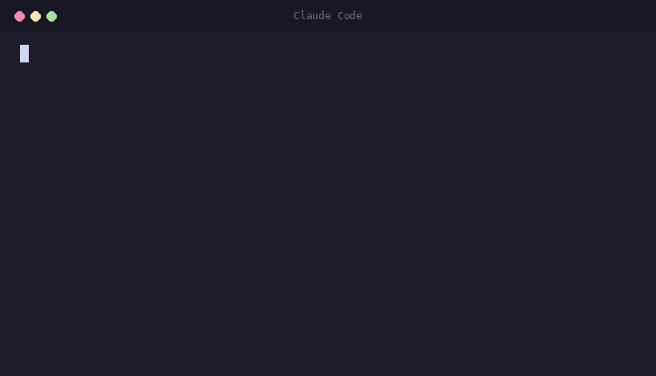

# 🧠 Super-Memory

<p align="center">
  <a href="LICENSE"></a>
  
  
  
  <a href="https://github.com/forjadeskills/super-memory/stargazers"></a>
</p>

**Memória automática e de baixo ruído para o Claude Code.**

<p align="center">
  
</p>

A maioria das ferramentas de memória grava *tudo* o que acontece e torce pra
coisa importante sobreviver no meio da bagunça. A Super-Memory faz o contrário:
ela lembra como um bom organizador humano lembraria — **um fato limpo por
arquivo, e nada além disso** — e se preenche **sozinha** ao fim de cada sessão.

> Feita pela **[Forja de Skills](https://github.com/forjadeskills)** para quem
> está começando no "vibe coding" ter memória de verdade, sem trabalho manual.

## Por que ela é diferente

- 🤫 **Silenciosa.** Se a sessão não teve nada que valha a pena lembrar, ela não
  escreve nada. Sem despejar conversa, sem guardar "cada clique".
- 🏠 **100% local e privada.** Roda na sua máquina. Sem conta na nuvem, sem chave
  de API além do próprio Claude Code que você já usa. Segredos são apagados
  antes de qualquer coisa ir pro disco.
- ✍️ **Escreve como você escreveria.** Um fato, uma frase, com o *porquê*. Quatro
  categorias honestas: quem você é, como gosta de trabalhar, estado do projeto e
  atalhos pra links/painéis.
- 🔁 **Atualiza em vez de empilhar.** Um fato novo que contradiz um antigo
  substitui o antigo. Sua memória fica pequena e verdadeira.
- 🧰 **Funciona em qualquer projeto** onde o Claude Code funciona.
- 🆓 **Grátis e aberta (MIT).**

## Como funciona (em 4 passos)

1. Um gatilho dispara quando sua sessão do Claude Code termina.
2. Ele entrega a conversa + o índice atual da sua memória para um modelo
   pequeno e barato, com uma única missão: destilar só os fatos duráveis,
   seguindo regras rígidas de baixo ruído.
3. O modelo devolve uma lista curta de operações (criar / atualizar / apagar).
4. Um script em Python, sem dependências, aplica tudo com segurança — só mexe
   em arquivos que ele mesmo criou, e só reescreve o próprio trecho do índice.

Pronto. Sem banco de dados pra manter, sem serviço pra vigiar.

## Instalação

Precisa do [Claude Code](https://claude.com/claude-code).

### Opção A — como plugin (recomendado, um comando)

Dentro do Claude Code:

```
/plugin marketplace add forjadeskills/super-memory
/plugin install super-memory@super-memory
```

Pronto — a skill, o comando `/memory-review` e o gatilho de captura automática
já vêm juntos. As memórias ficam em `~/.super-memory/memories/`.

### Opção B — manual (clonar + rodar o instalador)

```bash
git clone https://github.com/forjadeskills/super-memory.git
cd super-memory
bash install.sh
```

> Use **um** dos dois jeitos, não os dois — senão o gatilho roda duas vezes.

Por padrão suas memórias caem numa pasta de teste (`~/.super-memory/memories/`),
pra você ver exatamente o que ela escreve antes de confiar. Mude pra onde quiser:

```bash
export SUPER_MEMORY_DIR="$HOME/.super-memory/memories"   # onde guardar
export SUPER_MEMORY_MODEL="claude-haiku-4-5"             # modelo que destila
```

## Usando no dia a dia

- **Lembrar**: acontece quando você (ou o Claude) lê o `MEMORY.md` no começo do
  trabalho.
- **Gravar**: acontece sozinho ao fim da sessão — ou na hora, pela skill
  `super-memory`.
- **Faxina**: rode `/memory-review` pra ver todos os fatos guardados e apagar o
  que não quiser.

## O que ela guarda e o que NÃO guarda

**Guarda:** seu papel e preferências estáveis, como você quer que o Claude
trabalhe (com o motivo), decisões e restrições do projeto que não estão no
código, e atalhos pra painéis / tarefas / links.

**Não guarda:** nada que dê pra redescobrir no seu código ou histórico do Git,
conversa-fiada, segredos ou senhas, nem cópia parecida de algo que ela já sabe —
nesse caso ela atualiza o que já existe.

## Segurança

- Arquivos de memória escritos à mão **nunca** são lidos, movidos ou apagados. A
  ferramenta só toca em arquivos marcados com `managed_by: super-memory`.
- No `MEMORY.md`, ela só reescreve o trecho entre os marcadores dela.
- O `settings.json` é copiado (backup) antes de registrar o gatilho.
- Strings que parecem segredo (chaves de API, tokens, JWT, senhas) são apagadas.

## Licença

MIT — veja o arquivo [LICENSE](LICENSE). Contribuições são bem-vindas.

---

### In English 🇬🇧

Super-Memory is **low-noise, automatic long-term memory for Claude Code**. It
fills in by itself at the end of each session, keeping only durable facts — one
clean fact per file — and runs **100% locally**. Install as a plugin with
`/plugin marketplace add forjadeskills/super-memory` then
`/plugin install super-memory@super-memory`, or clone and run `bash install.sh`.
Built by [Forja de Skills](https://github.com/forjadeskills) to give people new
to AI coding real memory with zero busywork. MIT licensed.
